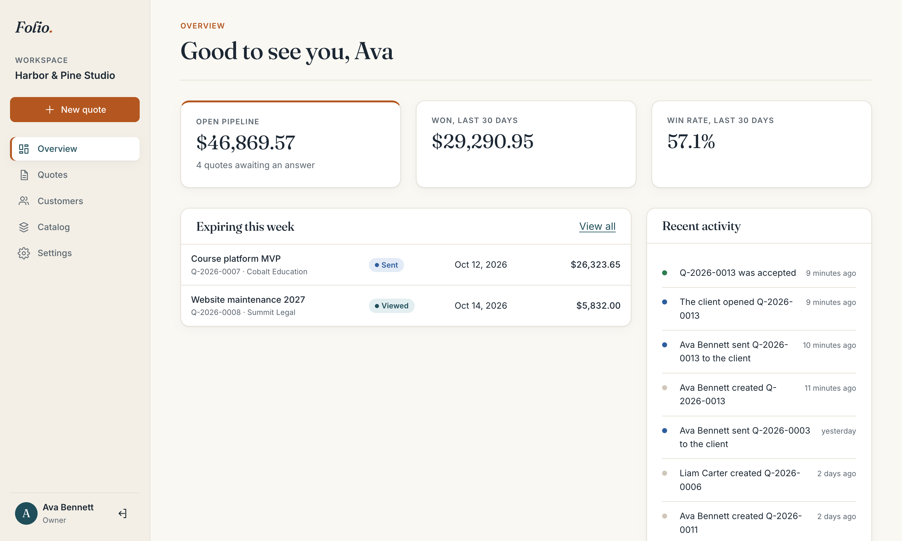
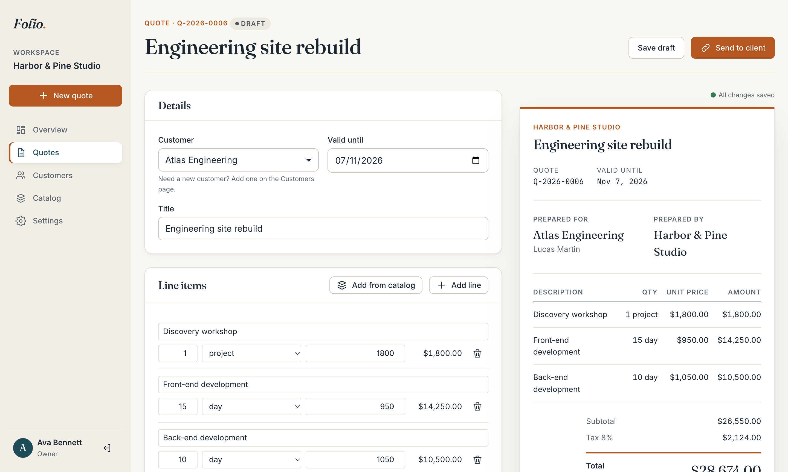
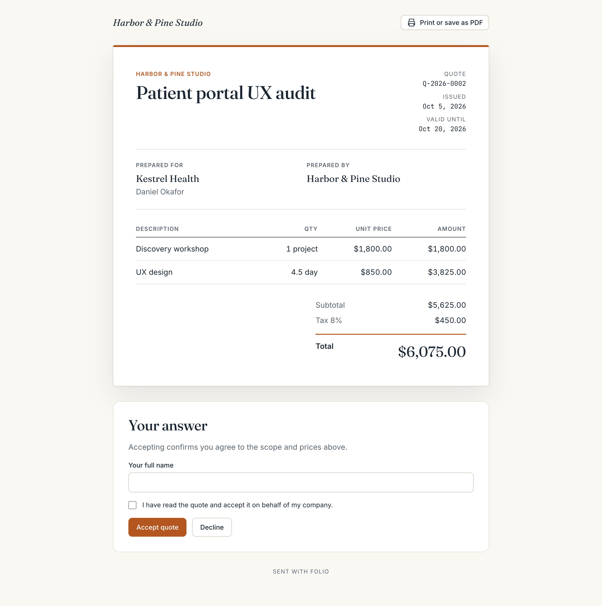
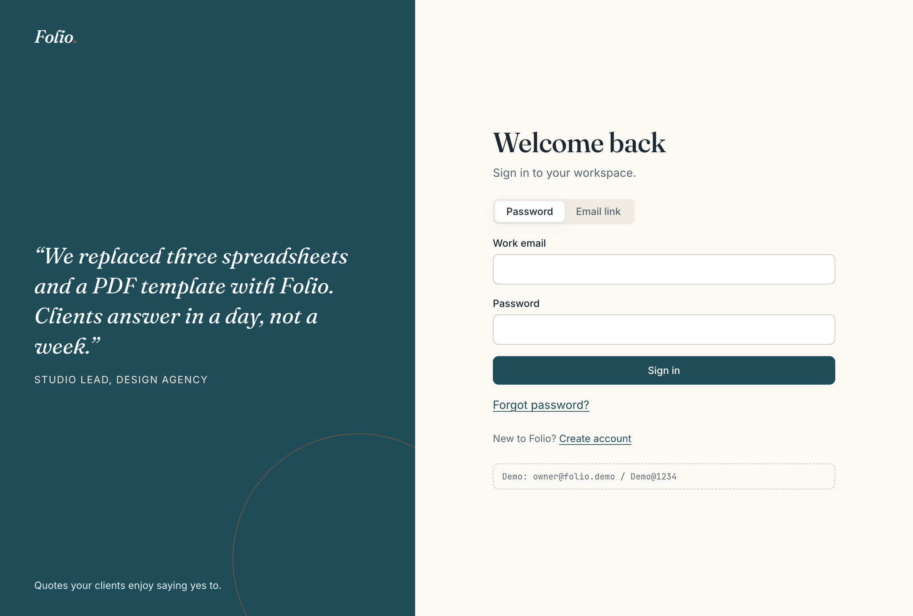
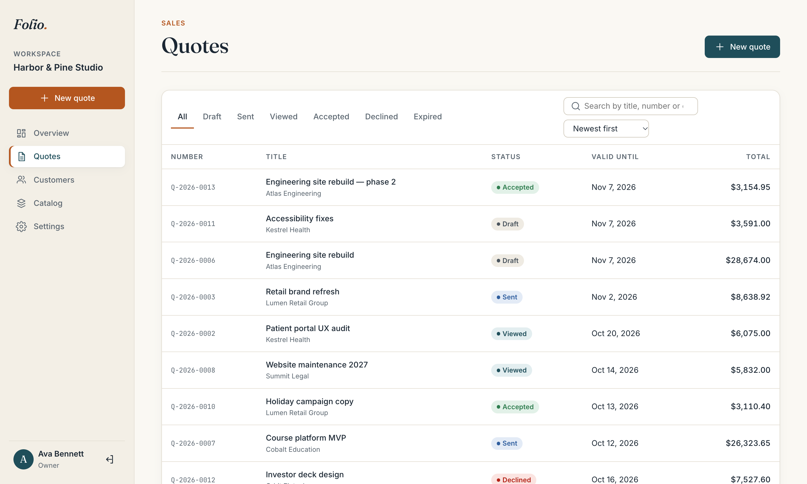
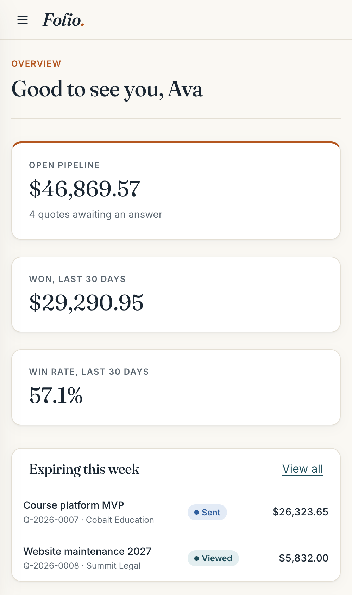
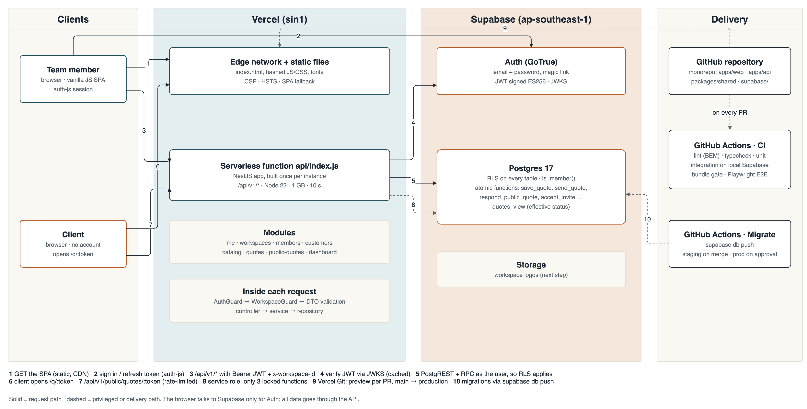

# Folio

**Quotes your clients enjoy saying yes to.**

Folio is a B2B workspace for building quotes and proposals. A studio builds a quote, sends it as a link, and sees which ones are won. The client opens the link without an account, reads a clean document and accepts or declines it.

It is a production-style showcase built to this brief:

> A polished B2B single-page app in **vanilla JavaScript and custom CSS (no frameworks)**, with **Node.js serverless functions on Vercel** and **Supabase** for authentication and data. A clean, minimal, editorial feel.



| Quote editor with live preview | What the client sees |
|---|---|
|  |  |

| Sign in | Quotes | Phone |
|---|---|---|
|  |  |  |

---

## Contents

1. [Features](#features)
2. [Tech stack](#tech-stack)
3. [Architecture](#architecture)
4. [Project structure](#project-structure)
5. [Run it locally](#run-it-locally)
6. [Tests and quality gates](#tests-and-quality-gates)
7. [Deploy to Vercel + Supabase](#deploy-to-vercel--supabase)
8. [API](#api)
9. [Design system](#design-system)
10. [Decisions and trade-offs](#decisions-and-trade-offs)
11. [Next steps](#next-steps)

---

## Features

| | Feature | Notes |
|---|---|---|
| 🔐 | Sign up, sign in, magic link, password reset | Supabase Auth |
| 🏢 | Workspaces | Onboarding creates one; the creator is the owner. Switch between workspaces from the sidebar |
| 👥 | Team | Invite by link (7 days, bound to the invited email), roles owner / admin / member, change role, remove. The last owner is always protected |
| 🧾 | Customers | Search, paginate, edit, archive / restore, quote history per customer |
| 📦 | Catalog | Products and services with unit and price. Prices are copied into quotes, so editing the catalog never changes a sent quote |
| ✍️ | Quote editor | Line items (typed or from the catalog), percent or fixed discount, tax, notes, valid-until. Live document preview, autosave |
| 🔗 | Send | One-time share link (32 random bytes; only the hash is stored). Sending again replaces the link |
| 🤝 | Client page `/q/:token` | No account needed, editorial document, print / save as PDF, accept with name and checkbox, or decline with a reason |
| 🔄 | Status | DRAFT → SENT → VIEWED → ACCEPTED / DECLINED / EXPIRED, enforced in both the API and the database |
| 📊 | Overview | Open pipeline, won (30 days), win rate, quotes expiring this week, recent activity |
| 🕓 | Activity log | Who created, sent, opened, accepted or declined each quote |
| 📱 | Responsive and accessible | 360 px and up, keyboard friendly, visible focus, WCAG AA contrast, `aria-live` toasts, native `<dialog>` modals |

Demo data: one workspace (*Harbor & Pine Studio*), 8 customers, 8 catalog items, 12 quotes in every status.

| Account | Password | Role |
|---|---|---|
| `owner@folio.demo` | `Demo@1234` | Owner |
| `member@folio.demo` | `Demo@1234` | Member |

Public demo link (after `db reset`): `http://localhost:5180/q/folio-demo-quote`

---

## Tech stack

| Layer | Choice |
|---|---|
| Frontend | Vanilla JavaScript (ES modules) with JSDoc types checked by `tsc --checkJs`; hand-written router, store, safe templates. Vite as the bundler only |
| Styling | Custom CSS, BEM, design tokens, `@layer`; Fraunces, Inter and JetBrains Mono, self-hosted |
| Backend | NestJS 11 (TypeScript strict) as **one Vercel serverless function** |
| Auth and data | Supabase Auth (JWT ES256 / JWKS), Postgres 17 with Row Level Security and Postgres functions |
| Shared code | `packages/shared`: every enum, constant, API interface and the quote maths, used by both apps |
| Tests | Vitest (shared, web), Jest + Supertest (API, against a real local Supabase), Playwright (E2E) |
| Quality | ESLint, Stylelint (BEM pattern, no raw colours), TypeScript, bundle budget and secret scan |
| Delivery | GitHub Actions (CI + migrations), Vercel Git integration (preview per PR, `main` → production) |
| Diagrams | draw.io files generated by a Python script, exported to PNG |

---

## Architecture



| # | Flow |
|---|---|
| 1 | The browser loads the static SPA from Vercel's CDN (CSP, HSTS, immutable hashed assets) |
| 2 | The SPA talks to Supabase **only for Auth**: sign in, token refresh, sign out |
| 3 | Every data request goes to `/api/v1/*` with `Authorization: Bearer <jwt>` and `x-workspace-id` |
| 4 | The API verifies the JWT against Supabase's JWKS, cached |
| 5 | The API queries Postgres **as the user**, so Row Level Security filters every row again |
| 6–7 | A client opens `/q/:token`; the public endpoints are rate-limited per IP |
| 8 | Only the public-quote module uses the service role, and only for three locked functions that check the token hash |
| 9 | Vercel deploys a preview for each pull request, and production from `main` |
| 10 | Migrations reach Supabase through a GitHub Actions workflow (staging on merge, production with approval) |

**Request pipeline in the API:** request id → `AuthGuard` → `WorkspaceGuard` + `@Roles` → `ValidationPipe` (DTO classes `implements` the shared interfaces) → controller → service (rules) → repository (supabase-js) → Postgres. Every error leaves as `{ error: { code, message, details, requestId } }`, and every success as `{ data, meta? }`.

| More diagrams | |
|---|---|
| [API request pipeline](docs/architecture/backend_layers.png) | [SPA structure](docs/architecture/frontend_spa.png) |
| [Data model (ERD)](docs/architecture/erd.png) | [Quote status](docs/architecture/quote_state.png) |

**Business flows (sequence diagrams):**
[B1 Sign up & onboarding](docs/architecture/flow_b1_signup_onboarding.png) ·
[B2 Authenticated request](docs/architecture/flow_b2_authenticated_request.png) ·
[B3 Save a quote](docs/architecture/flow_b3_save_quote.png) ·
[B4 Send a quote](docs/architecture/flow_b4_send_quote.png) ·
[B5 Client answers](docs/architecture/flow_b5_client_answers.png) ·
[B6 Invite a teammate](docs/architecture/flow_b6_invite_teammate.png) ·
[B7 Dashboard](docs/architecture/flow_b7_dashboard.png)

All `.drawio` sources are in [`docs/architecture`](docs/architecture). Run `npm run diagrams` to regenerate them.

---

## Project structure

```
folio/
├── api/index.js                 # Vercel function → apps/api/dist/serverless.js
├── apps/
│   ├── web/                     # vanilla JS SPA
│   │   └── src/
│   │       ├── core/            # dom (safe html``), router, store, api, auth, guards, copy (all UI text)
│   │       ├── state/           # session, workspace, toast
│   │       ├── components/      # one folder per BEM block: JS + CSS side by side
│   │       ├── pages/           # one folder per route
│   │       ├── styles/          # tokens.css (only file with colours), base, layout, layer order
│   │       └── utils/           # debounce, clipboard, list-query, relative-time
│   └── api/                     # NestJS
│       └── src/
│           ├── auth/            # AuthGuard, WorkspaceGuard, @Roles
│           ├── common/          # AppError, error filter, response envelope, pagination, tokens, logger
│           ├── supabase/        # the only place clients are created + generated DB types
│           └── modules/         # me, workspaces, members, customers, catalog, quotes, public-quotes, dashboard, health
├── packages/shared/             # enums, constants, interfaces, money, quote-status, format
├── supabase/
│   ├── migrations/              # schema · RLS · Postgres functions
│   └── seed.sql                 # demo data
├── e2e/                         # Playwright journey
├── docs/
│   ├── plan.md                  # requirements → design standards → decisions, work breakdown, implementation notes
│   ├── adr/                     # architecture decision records
│   ├── architecture/            # draw.io sources, generator, PNGs
│   └── screenshots/
├── scripts/check-bundle.mjs     # bundle budget + secret scan
└── vercel.json · playwright.config.ts · eslint.config.mjs · .stylelintrc.json
```

**One home for everything.** Enum → `packages/shared/src/enums.ts`; limit → `constants.ts`; API shape → `interfaces.ts`; UI text → `apps/web/src/core/copy.js`; colour → `apps/web/src/styles/tokens.css`. Postgres enums are checked against the shared enums in CI.

---

## Run it locally

Requirements: Node 20+, Docker (for the local Supabase stack).

```bash
git clone https://github.com/deputychinh/Folio.git && cd Folio
npm install

npx supabase start          # Postgres, Auth, Studio in Docker; runs migrations + seed
npx supabase status         # copy ANON_KEY and SERVICE_ROLE_KEY
cp .env.example .env        # paste the keys (SUPABASE_* and VITE_SUPABASE_*)

npm run dev                 # API on :3001, SPA on http://localhost:5180 (proxies /api)
```

Useful commands:

| Command | What it does |
|---|---|
| `npm run dev` | Build shared, then run the API (watch) and Vite together |
| `npx supabase db reset` | Re-apply migrations and the demo seed |
| `npm run build` | Build shared → API → SPA (what Vercel runs) |
| `npm test` | Unit tests in every workspace |
| `npm run test:integration` | API tests against local Supabase |
| `npm run e2e` | Playwright journey (starts the servers if they are not running) |
| `npm run lint` · `npm run typecheck` | ESLint + Stylelint · TypeScript |
| `npm run check:bundle` | JS budget (60 KB gzip) and secret scan of `apps/web/dist` |
| `npm run db:types` | Regenerate `database.types.ts` from the local schema |
| `npm run diagrams` | Regenerate the draw.io files and PNGs |

Supabase Studio: http://127.0.0.1:54323 · Emails sent locally (magic link, reset) appear in Mailpit: http://127.0.0.1:54324

---

## Tests and quality gates

| Suite | Count | What it proves |
|---|---|---|
| `packages/shared` (Vitest) | 57 | Money maths and rounding, every status transition, formatting. 100 % statements |
| `apps/api` unit (Jest) | 37 | Server-side totals, edit and send rules, one-time tokens, invite rules, error mapping, Postgres enums = shared enums |
| `apps/api` integration (Jest + Supertest, real Supabase) | 17 | Journeys B1/B3/B4/B5, workspace isolation (guard + RLS), roles, last owner, rate limit + `Retry-After`, seed totals = shared maths |
| `apps/web` (Vitest + jsdom) | 14 | XSS escaping in templates and attributes, router, store, URL filters, relative time |
| E2E (Playwright) | 1 journey | Sign up → workspace → customer (with HTML in its name) → quote → send → the client accepts in another browser → the dashboard shows the win |

CI (`.github/workflows/ci.yml`) runs on every pull request: lint → typecheck → unit → start Supabase → check that the generated DB types are current → integration → build → bundle and secret gate → Playwright.

---

## Deploy to Vercel + Supabase

1. **Supabase**: create a project (region `ap-southeast-1`), then push the schema:
   ```bash
   npx supabase link --project-ref <ref>
   npx supabase db push
   ```
   In *Auth → URL configuration*, set the site URL to your Vercel domain and add `https://<domain>/**` to the redirect URLs.
2. **Vercel**: import the repository. `vercel.json` already sets the build command, output directory, function, rewrites, security headers and region (`sin1`). Add these environment variables:

   | Name | Value | Exposed to the browser |
   |---|---|---|
   | `SUPABASE_URL` | `https://<ref>.supabase.co` | no |
   | `SUPABASE_ANON_KEY` | anon key | no |
   | `SUPABASE_SERVICE_ROLE_KEY` | service role key | **never** |
   | `APP_URL` | `https://<domain>` | no |
   | `VITE_SUPABASE_URL` | same as `SUPABASE_URL` | yes |
   | `VITE_SUPABASE_ANON_KEY` | same as `SUPABASE_ANON_KEY` | yes |

3. **GitHub**: for the migrate workflow, add the secrets `SUPABASE_ACCESS_TOKEN` and `SUPABASE_DB_PASSWORD`, the variable `SUPABASE_PROJECT_REF`, and the environments `staging` and `production` (production with required reviewers).
4. Optional: load the demo data into a demo project with `psql "$DATABASE_URL" -f supabase/seed.sql`.

Each pull request gets a preview URL. A merge to `main` deploys production.

---

## API

Base path `/api/v1`. Private routes need `Authorization: Bearer <access token>`; workspace routes also need `x-workspace-id`.

| Method | Path | Who | |
|---|---|---|---|
| GET | `/health` | anyone | liveness + DB check |
| GET | `/me` | user | profile, workspaces, role in each |
| POST | `/workspaces` | user | onboarding |
| GET · PATCH | `/workspaces/current` | member · owner/admin | settings, branding |
| GET | `/members` | member | team |
| GET · POST | `/members/invites` | owner/admin | pending invites · new invite (returns the link once) |
| DELETE | `/members/invites/:id` | owner/admin | revoke |
| PATCH · DELETE | `/members/:userId` | owner/admin | change role · remove (last owner protected) |
| POST | `/invites/:token/accept` | user | join a workspace |
| GET · POST | `/customers` | member | list (search, page, archived) · create |
| GET · PATCH · DELETE | `/customers/:id` | member | detail with quotes · edit · archive |
| POST | `/customers/:id/restore` | member | un-archive |
| GET · POST | `/catalog` | member | list · create |
| PATCH | `/catalog/:id` | member | edit / deactivate |
| GET · POST | `/quotes` | member | list (status, customer, search, sort, page) · create draft |
| GET · PUT | `/quotes/:id` | member | detail · save draft |
| POST | `/quotes/:id/send` | member | DRAFT → SENT, returns the share URL once |
| POST | `/quotes/:id/duplicate` | member | new draft |
| GET | `/quotes/:id/events` | member | activity |
| GET | `/dashboard` | member | summary |
| GET | `/public/quotes/:token` | anyone, 30/min/IP | client view |
| POST | `/public/quotes/:token/respond` | anyone, 30/min/IP | accept / decline |

Error codes (`ErrorCode` in shared): `VALIDATION_ERROR 422`, `UNAUTHORIZED 401`, `FORBIDDEN 403`, `NOT_FOUND 404`, `CONFLICT 409`, `INVALID_TRANSITION 409`, `QUOTE_EXPIRED 410`, `RATE_LIMITED 429`, `INTERNAL_ERROR 500`.

---

## Design system

The look is inspired by a printed business proposal: warm paper, deep ink, one confident accent.

| Token | Hex | Use | Contrast |
|---|---|---|---|
| ink-900 | `#1B2733` | text, headings | 14.3 : 1 on paper |
| teal-700 | `#1F4E5A` | **primary**: buttons, links, active nav | 8.6 : 1 (white text 9.2 : 1) |
| ochre-600 | `#B4561F` | **accent**: new quote, totals rule, brand dot | 4.6 : 1 (white text 4.9 : 1) |
| paper | `#FAF8F3` | app background | — |
| stone-500 | `#5B6670` | muted text | 5.5 : 1 |
| green / red / amber / blue 700 | `#2F7D4F` `#B42318` `#8A5E00` `#2F5E9E` | status colours | all ≥ 4.5 : 1 |

Type: **Fraunces** for headings and big numbers, **Inter** for the interface, **JetBrains Mono** for quote numbers.

CSS rules, enforced by Stylelint:
- BEM only: `.quote-card`, `.quote-card__total`, `.quote-card--expired`. One block per file, and the file is named after the block.
- Raw colours only in `tokens.css`. Components use semantic tokens (`--color-primary`, `--ring`, `--space-4` …).
- Layers `tokens, base, layout, components, pages`. No IDs, no `!important`, at most 3 compound selectors.

---

## Decisions and trade-offs

The full reasoning is in [`docs/plan.md`](docs/plan.md) (requirements → design standards → decisions, plus what was built versus planned in §18) and in the ADRs:

- [ADR-0001](docs/adr/0001-vanilla-spa.md): vanilla JS SPA with a hand-written router, store and safe templates.
- [ADR-0002](docs/adr/0002-nestjs-on-vercel.md): NestJS as one cached Vercel function.
- [ADR-0003](docs/adr/0003-rls-plus-api-guards.md): API guards **and** Row Level Security; atomic writes in Postgres functions.
- [ADR-0004](docs/adr/0004-money-and-shared-calculation.md): money as integer minor units, one shared calculation.
- [ADR-0005](docs/adr/0005-bem-and-design-tokens.md): BEM and two-level design tokens.

Security in short:
- Every query runs as the user, under RLS.
- The service role is limited to three functions.
- Share and invite tokens are 32 random bytes, and only their hash is stored.
- Public endpoints are rate-limited.
- Strict CSP with no inline script or style.
- All markup goes through an escaping template; ESLint blocks `innerHTML`.
- CI scans the bundle for secrets.

---

## Next steps

- Workspace logo upload (Supabase Storage). The accent colour is already in place.
- Email the quote and invite links (for example with Resend); today the member copies them.
- PDF rendered on the server, and e-signature with an audit certificate.
- Invoices from accepted quotes; multi-currency per quote.
- i18n: all UI text already lives in `core/copy.js`.
- Dark mode: only `tokens.css` needs a second semantic layer.
