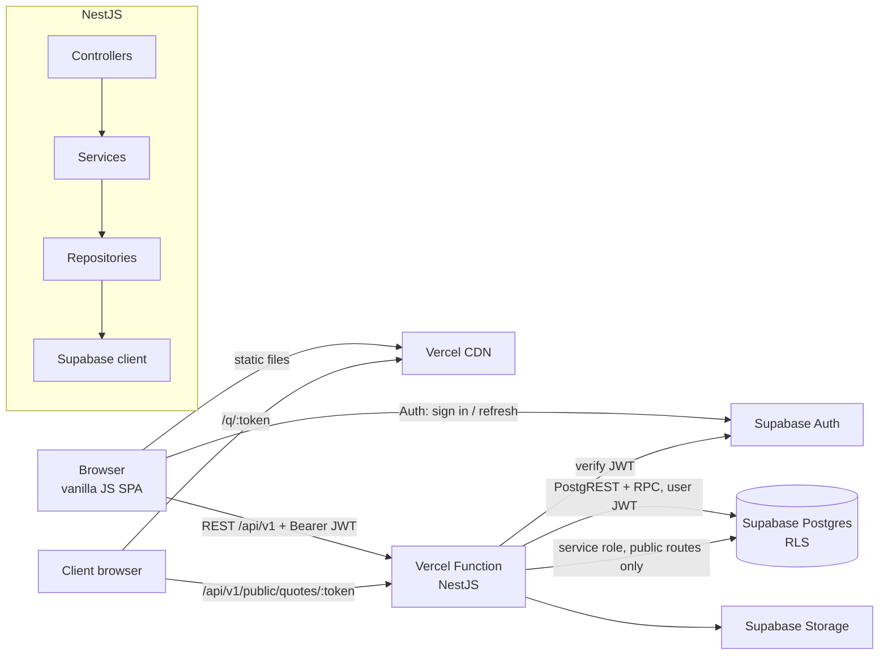

# Folio — B2B Quote & Proposal Workspace — Project Plan

> A production-style showcase project for the role: *"full-stack developer to build a polished B2B single-page app using vanilla JavaScript and custom CSS (no frameworks), Node.js serverless functions on Vercel, Supabase for auth and data, an editorial and professional feel."*
>
> Frontend: **vanilla JavaScript (ES modules) + hand-written CSS in BEM**, no UI framework.
> Backend: **NestJS (TypeScript)** running as **one Vercel serverless function**.
> Auth + data: **Supabase** (Auth, Postgres with Row Level Security, Storage).
> Diagrams: **draw.io** (architecture, ERD, one sequence diagram per business flow).
>
> Status: **APPROVED 2026-10-08** (decisions in §17). Code lives in `b2b/folio/`.

---

## 1. Goals

| What the client asks for | How this project shows it |
|---|---|
| Polished B2B single-page app | Real B2B product (quotes, customers, catalog, team), client-side router, loading / empty / error state on every view |
| Vanilla JavaScript, no frameworks | ~15 small core modules (router, store, api, dom) written by hand, no React/Vue/Lit; only `@supabase/supabase-js` as a runtime dependency |
| Custom CSS, clean minimal UX | Design tokens + BEM, one brand palette, editorial typography, no CSS framework |
| Node.js serverless functions on Vercel | NestJS app wrapped in one Vercel function (`/api/*`), cold-start measured and kept small |
| Supabase auth and data | Supabase Auth (email + password, magic link), Postgres with RLS for workspace isolation, Storage for logos |
| Maintainable code, thoughtful design decisions | One source of truth for enums / constants / interfaces, layered backend, ADRs, traceability FR → DS → decision |
| Feels editorial and professional | Serif headings, generous whitespace, the public quote page looks like a printed proposal |

**Main aim: simple, explicit code that a new developer can read in one afternoon.** No magic strings, no duplicated types, no clever abstractions. When two options work, the simpler one wins.

---

## 2. Product scope (MVP)

**Folio** helps small B2B service companies (agencies, studios, consultants, IT suppliers) build quotes, send them to clients as a clean link, and see which ones are won.

### Personas
- **Owner:** creates the workspace, sets branding, invites the team, sees all numbers.
- **Member (sales):** manages customers and the catalog, builds and sends quotes.
- **Client (no account):** opens the quote link, reads it, accepts or declines.

### Features: in scope
| # | Feature | Notes |
|---|---|---|
| F1 | Sign up, log in, log out, reset password | Supabase Auth, email + password and magic link |
| F2 | Workspace onboarding | Company name, currency, tax rate, logo; creator becomes OWNER |
| F3 | Team | Invite link for an email address (copied by the owner), roles OWNER / ADMIN / MEMBER, remove member |
| F4 | Customers | Company + main contact, search, list, detail with its quotes |
| F5 | Catalog | Products / services with unit, unit price, active flag |
| F6 | Quote editor | Line items (from catalog or free text), discount, tax, notes, valid-until, live totals |
| F7 | Quote lifecycle | DRAFT → SENT → VIEWED → ACCEPTED / DECLINED / EXPIRED, duplicate quote |
| F8 | Share link | Public URL `/q/:token`, no login, editorial "document" layout, print to PDF |
| F9 | Client response | Accept (typed name + checkbox) or decline (reason) |
| F10 | Dashboard | Open pipeline value, win rate (30 days), quotes expiring in 7 days, recent activity |
| F11 | Activity log | Who did what on each quote (created, sent, viewed, accepted …) |

### Out of scope (written as "next steps" in the README)
Sending the quote by email (the member copies the share link instead), payments / invoicing, e-signature with legal certificate, multi-currency per quote, PDF rendered on the server, email open tracking, any UI language other than English (all copy lives in one file, so i18n stays possible), mobile app.

---

## 2A. Requirements → design standards → decisions

Each choice in this plan traces back to a requirement: **requirement (FR/NFR) → design standard (DS) → decision**. §2A.4 is the check that nothing was added "because it looks senior".

### 2A.1 Functional requirements (FR)

| ID | Requirement | Actor | Priority |
|---|---|---|---|
| FR-01 | Sign up, log in (password or magic link), log out, reset password | Visitor | Must |
| FR-02 | Create a workspace on first login; the creator is OWNER | User | Must |
| FR-03 | Invite members with an invite link tied to their email, set their role; remove members | Owner/Admin | Must |
| FR-04 | Create, edit, search and archive customers | Member | Must |
| FR-05 | Create, edit and deactivate catalog items | Member | Must |
| FR-06 | Build a quote with line items, discount and tax; totals update live | Member | Must |
| FR-07 | Send a quote: it gets a share link and moves to SENT | Member | Must |
| FR-08 | A client opens the link without an account; the first open moves it to VIEWED | Client | Must |
| FR-09 | A client accepts or declines the quote | Client | Must |
| FR-10 | A quote past its valid-until date shows as EXPIRED and cannot be accepted | System | Must |
| FR-11 | Dashboard: pipeline value, win rate, expiring soon, recent activity | Member | Should |
| FR-12 | Activity log per quote | Member | Should |
| FR-13 | Workspace branding (logo, accent on the public quote) | Owner | Could |

### 2A.2 Non-functional requirements (NFR)

| ID | Quality | Requirement (measurable) |
|---|---|---|
| NFR-01 | Performance | First load JS ≤ 60 KB gzip (supabase-js included), LCP < 2.0 s on 4G; API p95 < 400 ms warm, cold start < 1.5 s |
| NFR-02 | Security | Every table has RLS; the API checks the JWT and the workspace role; public link token is 32 random bytes stored as a hash; rate limit on public endpoints; strict CSP; no user data through `innerHTML` without escaping |
| NFR-03 | Data integrity | Money as integer minor units (`bigint`), quote + items saved in one DB transaction (Postgres function), state changes only through allowed transitions |
| NFR-04 | Maintainability | Enums, constants and interfaces defined once in `packages/shared`; ESLint + Stylelint (BEM pattern, no raw colours) clean; no file > 300 lines |
| NFR-05 | Testability | ≥ 80 % coverage on services and shared logic; each business rule has a unit test; the main journey has one Playwright E2E test |
| NFR-06 | Usability & a11y | Responsive from 360 px, WCAG 2.1 AA contrast, full keyboard use, focus visible, `aria-live` for toasts |
| NFR-07 | Observability | JSON logs with request id, `/api/health`, Vercel logs + Supabase logs, error envelope with `requestId` |
| NFR-08 | Deployability | One command locally (`npm run dev`), preview deploy per pull request, `main` → production, DB migrations versioned in git |
| NFR-09 | Cost | Runs on Vercel Hobby/Pro + Supabase Free/Pro; no other paid service needed for the MVP |

### 2A.3 Design standards (DS)

| ID | Rule every change must follow | From |
|---|---|---|
| DS-01 | **Single source of truth:** enums, constants, interfaces and shared pure functions live in `packages/shared` only; FE and BE import them | NFR-04 |
| DS-02 | **Layered backend:** controller → service → repository. Controllers hold no logic; services know nothing about HTTP or Supabase | NFR-04, NFR-05 |
| DS-03 | **Defence in depth:** API guard checks role, and Postgres RLS checks workspace membership again | NFR-02 |
| DS-04 | **Atomic writes in the DB:** any write that touches more than one row runs as one Postgres function (RPC) | NFR-03 |
| DS-05 | **Stateless function:** nothing kept in function memory except the cached Nest app instance | NFR-01, NFR-08 |
| DS-06 | **BEM + tokens:** every class is `block`, `block__element` or `block--modifier`; every colour, space, radius and font comes from `tokens.css` | NFR-04, NFR-06 |
| DS-07 | **Safe DOM:** templates go through the `html` tagged template, which escapes values; raw HTML is never built from user input | NFR-02 |
| DS-08 | **Simple names:** a util name says what it does (`formatMoney`, not `helper2`); no `helpers.js`, `misc.js`, `common-utils.js` | NFR-04 |
| DS-09 | **Test pyramid:** unit tests on services and shared logic, integration tests on the API against local Supabase, one E2E for the main journey | NFR-05 |
| DS-10 | **Everything as code:** migrations, RLS, seed, CI, Vercel config and diagrams are in git | NFR-08 |

### 2A.4 Traceability: decision → why

| Decision (section) | Why |
|---|---|
| Vanilla JS SPA with own router/store (§8) | Client requirement; FR-01…FR-12; NFR-01 bundle budget |
| NestJS in one Vercel function (§7, §12) | Client asks for Node serverless on Vercel; user asked for NestJS; DS-02, DS-05 |
| `packages/shared` (§6) | DS-01; the same `calcQuoteTotals` runs in the editor (live) and on the server (truth) — FR-06, NFR-03 |
| supabase-js (HTTP) instead of a TCP pool | Serverless functions cannot keep a DB pool; PostgREST over HTTP needs none — DS-05 |
| User-scoped Supabase client in the API | RLS applies to API calls too — DS-03, NFR-02 |
| Postgres functions for save-quote / send / accept (§7.5) | DS-04, NFR-03 |
| Hashed share token + rate limit (§7.7) | FR-08, FR-09, NFR-02 |
| Quote state machine in shared (§6.1) | FR-07…FR-10, NFR-03 |
| BEM + Stylelint rules (§8.5, §13) | DS-06, NFR-04 |
| One Playwright journey (§7.9) | NFR-05 |

---

## 3. Tech stack

| Layer | Choice | Why |
|---|---|---|
| Frontend language | Vanilla JavaScript (ES2022 modules), JSDoc types checked by `tsc --checkJs` | No framework, but still type-checked |
| Frontend tooling | Vite (build + dev server only, no framework plugin) | Fast dev, hashed files, env vars; it is a bundler, not a framework |
| Styling | Hand-written CSS, BEM, CSS custom properties, `@layer` | Client requirement, full control |
| Fonts | Fraunces (headings, serif), Inter (UI text), JetBrains Mono (numbers in tables) — self-hosted woff2 | Editorial look, no third-party request |
| Backend | NestJS 11, TypeScript strict, Express adapter | Clear modules, DI, guards, pipes; user requirement |
| Validation | `class-validator` DTOs that `implements` the shared interfaces | Nest idiom; the interface still comes from one place |
| Hosting | Vercel: static SPA + one Node function (`api/index.js`) | Client requirement |
| Auth / DB / files | Supabase Auth, Postgres 17 + RLS, Storage | Client requirement |
| Tests | Vitest (shared + FE), Jest + Supertest (Nest), Playwright (E2E) | |
| Quality | ESLint, Prettier, Stylelint (`stylelint-selector-bem-pattern`, `declaration-strict-value`), `tsc --noEmit` | |
| Monorepo | npm workspaces | No extra tool needed |
| CI | GitHub Actions (lint, typecheck, test); Vercel Git integration (preview + production) | |
| Diagrams | draw.io files generated by a Python script, PNG exported with the draw.io CLI | Same approach as the real-estate project |

---

## 4. Architecture



**Rules**
- The browser talks to Supabase **only for Auth** (sign in, refresh, sign out). All data goes through the API, so business rules are in one place.
- The API calls Supabase with the **user's JWT**, so RLS still protects every row (DS-03).
- The **service-role key** is used only by the public-quote module, and only through two Postgres functions that check the token hash themselves.
- Static SPA and API are on the same Vercel domain → no CORS in production.

Diagram files: §11.

---

## 5. Repository layout

```
b2b/folio/
├── README.md                     # pitch, screenshots, one-command setup, demo accounts
├── package.json                  # npm workspaces + root scripts (dev, build, lint, test)
├── vercel.json                   # build output, /api rewrite, SPA fallback, security headers
├── .env.example
├── .github/workflows/ci.yml
├── api/
│   └── index.js                  # Vercel function entry → apps/api/dist/serverless.js
├── apps/
│   ├── web/                      # vanilla JS SPA (§8)
│   └── api/                      # NestJS (§7)
├── packages/
│   └── shared/                   # enums, constants, interfaces, pure logic (§6)
├── supabase/
│   ├── config.toml
│   ├── migrations/               # schema, RLS, functions — numbered SQL files
│   └── seed.sql                  # demo workspace, customers, catalog, quotes
├── e2e/                          # Playwright journey
└── docs/
    ├── plan.md                   # this file
    ├── adr/                      # 0001-vanilla-spa.md, 0002-nest-on-vercel.md …
    ├── architecture/             # .drawio + generator + PNG exports (§11)
    └── screenshots/
```

---

## 6. Shared package (`packages/shared`) — the single source of truth

Built with `tsup` into ESM (for Vite) and CJS (for Nest) plus `.d.ts`. Nothing else in the repo may declare an enum, a status string, a limit or an API shape.

```
packages/shared/src/
├── index.ts          # re-exports everything below
├── enums.ts          # ALL enums
├── constants.ts      # ALL limits, TTLs, routes, regex
├── interfaces.ts     # ALL API request/response shapes
├── quote-status.ts   # allowed transitions + canTransition()
├── money.ts          # toMinor, fromMinor, calcLineTotal, calcQuoteTotals
└── format.ts         # formatMoney, formatDate, formatPercent
```

### 6.1 Enums (`enums.ts`)

String enums as `const` objects (they work in plain JS too) + a matching type.

```ts
export const WorkspaceRole = { OWNER: 'owner', ADMIN: 'admin', MEMBER: 'member' } as const;
export const QuoteStatus   = { DRAFT: 'draft', SENT: 'sent', VIEWED: 'viewed',
                               ACCEPTED: 'accepted', DECLINED: 'declined', EXPIRED: 'expired' } as const;
export const QuoteEventType = { CREATED, UPDATED, SENT, VIEWED, ACCEPTED, DECLINED, DUPLICATED };
export const Currency      = { USD, EUR, GBP, SGD, VND, AUD };
export const CatalogUnit   = { HOUR, DAY, ITEM, MONTH, PROJECT };
export const DiscountType  = { PERCENT, AMOUNT };
export const InviteStatus  = { PENDING, ACCEPTED, REVOKED };
export const QuoteSort     = { NEWEST, VALUE_DESC, VALID_UNTIL_ASC };
export const ErrorCode     = { VALIDATION_ERROR, UNAUTHORIZED, FORBIDDEN, NOT_FOUND,
                               CONFLICT, INVALID_TRANSITION, QUOTE_EXPIRED, RATE_LIMITED, INTERNAL_ERROR };
export type QuoteStatus = (typeof QuoteStatus)[keyof typeof QuoteStatus];   // same for each enum
```

The Postgres enum types in `supabase/migrations` use the same values. A test (`enums.contract.test.ts`) reads the DB enums from local Supabase and fails if they differ.

### 6.2 Constants (`constants.ts`)

```ts
export const API_PREFIX = '/api/v1';
export const PAGE_SIZE_DEFAULT = 20;
export const PAGE_SIZE_MAX = 100;
export const QUOTE_VALID_DAYS_DEFAULT = 30;
export const QUOTE_ITEMS_MAX = 100;
export const QUOTE_NUMBER_PREFIX = 'Q-';
export const SHARE_TOKEN_BYTES = 32;
export const PUBLIC_RATE_LIMIT = { requests: 30, windowSeconds: 60 };
export const EXPIRING_SOON_DAYS = 7;
export const WIN_RATE_WINDOW_DAYS = 30;
export const TAX_RATE_MAX_PERCENT = 50;
export const SEARCH_DEBOUNCE_MS = 250;
export const TOAST_DURATION_MS = 4000;
export const ROUTES = { LOGIN: '/login', DASHBOARD: '/', QUOTES: '/quotes', QUOTE: '/quotes/:id',
                        CUSTOMERS: '/customers', CATALOG: '/catalog', SETTINGS: '/settings',
                        PUBLIC_QUOTE: '/q/:token' };
```

### 6.3 Interfaces (`interfaces.ts`)

API shapes only (what crosses HTTP). DB row types are generated by `supabase gen types` and stay inside `apps/api`.

```ts
export interface ApiSuccess<T> { data: T; meta?: PageMeta }
export interface ApiError { error: { code: ErrorCode; message: string; details?: unknown; requestId: string } }
export interface PageMeta { page: number; pageSize: number; total: number }
export interface QuoteItemInput { catalogItemId?: string; name: string; quantity: number; unitPriceMinor: number; unit: CatalogUnit }
export interface SaveQuoteInput { customerId: string; title: string; validUntil: string; items: QuoteItemInput[];
                                  discountType: DiscountType; discountValue: number; taxPercent: number; notes?: string }
export interface QuoteTotals { subtotalMinor: number; discountMinor: number; taxMinor: number; totalMinor: number }
export interface QuoteView extends QuoteTotals { id: string; number: string; status: QuoteStatus; … }
export interface PublicQuoteView { … }   // no internal ids, no member emails
// Customer*, CatalogItem*, Member*, Invite*, DashboardSummary, ActivityItem …
```

### 6.4 Shared logic
- `calcQuoteTotals(items, discount, taxPercent)` — integer maths, rounding rule written once (half-up on minor units). The editor uses it for live totals; the server recomputes and **never trusts totals sent by the browser**.
- `canTransition(from, to)` — reads `QUOTE_TRANSITIONS`; used by the service (rule) and by the UI (which buttons to show).

**Util rule (DS-08):** a function goes into `shared` only if both FE and BE use it; into `apps/web/src/utils` or `apps/api/src/common` if only one side uses it; otherwise it stays next to its only caller.

---

## 7. Backend design (NestJS on Vercel)

### 7.1 Folder structure

```
apps/api/src/
├── app.module.ts
├── main.ts                       # local dev: app.listen(3001)
├── serverless.ts                 # Vercel: build the app once, cache it, hand req/res to Express
├── config/
│   └── env.ts                    # read + validate env once (SUPABASE_URL, keys, APP_URL …)
├── common/                       # API-only shared code (not FE)
│   ├── app-error.ts              # AppError(code, message, status) — the only error services throw
│   ├── error.filter.ts           # AppError / validation / unknown → ApiError envelope
│   ├── response.interceptor.ts   # wraps results in { data, meta }
│   ├── request-id.middleware.ts
│   ├── logger.ts                 # JSON logs with requestId
│   └── pagination.ts             # PageQuery DTO, toRange()
├── auth/
│   ├── auth.guard.ts             # Bearer JWT → supabase.auth.getUser → req.user
│   ├── workspace.guard.ts        # x-workspace-id header → membership + role
│   ├── roles.decorator.ts        # @Roles(WorkspaceRole.OWNER, …)
│   └── current-user.decorator.ts
├── supabase/
│   ├── supabase.module.ts
│   └── supabase.service.ts       # forUser(jwt), admin() — the only place createClient is called
└── modules/
    ├── me/          {me.controller, me.service}
    ├── workspaces/  {controller, service, repository, dto/}
    ├── members/     {controller, service, repository, dto/}     # invites, roles
    ├── customers/   {controller, service, repository, dto/}
    ├── catalog/     {controller, service, repository, dto/}
    ├── quotes/      {controller, service, repository, dto/}
    ├── public-quotes/{controller, service, repository}           # token routes, no auth
    ├── dashboard/   {controller, service, repository}
    └── health/      {controller}
```

Every module has the same four files. A reviewer who has read one module has read them all.

### 7.2 Patterns (each with a reason)

| Pattern | Where | Why |
|---|---|---|
| Layered | controller → service → repository | Rules testable without HTTP or a DB |
| Repository | `*.repository.ts` wraps supabase-js | Query code in one place; services get plain objects |
| Dependency injection | Nest providers | Fake repositories in unit tests |
| DTO + interface | `class SaveQuoteDto implements SaveQuoteInput` | Validation on the class, shape from shared |
| Guard | `AuthGuard`, `WorkspaceGuard` + `@Roles` | Access rules declared on the route, not hidden in services |
| State machine | `QUOTE_TRANSITIONS` + `canTransition` | One place that says which status can follow which |
| Exception filter | `error.filter.ts` | One error JSON for every failure |
| Cached singleton | `serverless.ts` keeps the Nest app between invocations | Cold start paid once per instance |

Not used on purpose: CQRS, event bus, generic base repository, mapper libraries. They add files without adding value at this size.

### 7.3 Data model (Supabase Postgres)

```
profiles          id (= auth.users.id) PK, full_name, created_at
workspaces        id PK, name, currency, tax_percent, logo_path, brand_accent, created_by, created_at
workspace_members workspace_id FK, user_id FK, role workspace_role, created_at   PK (workspace_id, user_id)
invites           id PK, workspace_id FK, email, role, status invite_status, token_hash, expires_at
customers         id PK, workspace_id FK, company_name, contact_name, email, phone, address, archived_at, created_at
catalog_items     id PK, workspace_id FK, name, description, unit catalog_unit, unit_price_minor bigint, active bool
quotes            id PK, workspace_id FK, customer_id FK, number text, title, status quote_status,
                  currency, valid_until date, discount_type, discount_value, tax_percent,
                  subtotal_minor, discount_minor, tax_minor, total_minor bigint,
                  share_token_hash text UNIQUE NULL, sent_at, viewed_at, responded_at,
                  client_name, decline_reason, notes, created_by FK, created_at, updated_at
quote_items       id PK, quote_id FK ON DELETE CASCADE, position int, catalog_item_id FK NULL,
                  name, unit, quantity numeric(12,2), unit_price_minor bigint, line_total_minor bigint
quote_events      id PK, quote_id FK, workspace_id FK, type quote_event_type, actor_id NULL, meta jsonb, created_at
rate_limit_hits   key text, window_start timestamptz, count int   PK (key, window_start)
```

Indexes: `(workspace_id, status, created_at desc)` on quotes, `(workspace_id, lower(company_name))` on customers, `quote_events (quote_id, created_at)`.
Quote number: per-workspace sequence → `Q-2026-0042`, set inside `save_quote`.

ERD is drawn in `docs/architecture/erd.drawio` (§11).

### 7.4 Row Level Security
- Helper: `is_member(ws uuid, roles workspace_role[] default null) returns bool` (`security definer`, reads `workspace_members` for `auth.uid()`).
- Every workspace table: `using (is_member(workspace_id))`; writes on `workspace_members`, `invites`, `workspaces` need `is_member(workspace_id, '{owner,admin}')`.
- `quotes` / `quote_items` have **no public policy**. Clients never read tables directly; the public module calls `get_public_quote(token_hash)` and `respond_public_quote(token_hash, …)`.
- An RLS test suite (SQL via `supabase test db` / pgTAP) proves user A cannot read workspace B.

### 7.5 Postgres functions (atomic writes, DS-04)

| Function | What it does in one transaction |
|---|---|
| `create_workspace(name, currency, tax)` | insert workspace + OWNER membership |
| `save_quote(quote_id null, payload jsonb)` | upsert quote, replace items, write totals, add event; only in DRAFT |
| `send_quote(quote_id, token_hash)` | check DRAFT, set SENT + `sent_at` + token hash, add event |
| `get_public_quote(token_hash)` | return the client view; on first open set VIEWED + event; mark EXPIRED if past `valid_until` |
| `respond_public_quote(token_hash, accept bool, name, reason)` | check SENT/VIEWED and not expired, set ACCEPTED/DECLINED, add event |
| `accept_invite(token_hash)` | add membership, mark invite ACCEPTED |
| `rate_limit_hit(key, limit, window)` | upsert counter, return whether the call is allowed |

The service still recomputes totals and checks `canTransition` **before** calling the function, so errors are clear (`INVALID_TRANSITION`) and the function is the last line of defence.

### 7.6 REST API (`/api/v1`)

All private routes need `Authorization: Bearer <supabase access token>`; workspace routes also need `x-workspace-id`.

| Method | Path | Role | Purpose |
|---|---|---|---|
| GET | `/health` | — | Liveness + DB ping |
| GET | `/me` | user | Profile + workspaces + role in each |
| POST | `/workspaces` | user | Onboarding (`create_workspace`) |
| PATCH | `/workspaces/current` | owner/admin | Name, currency, tax, branding |
| GET / POST | `/members`, `/members/invites` | owner/admin | List members, invite |
| PATCH / DELETE | `/members/:userId` | owner/admin | Change role, remove (cannot remove last owner) |
| POST | `/invites/:token/accept` | user | Join a workspace |
| GET / POST | `/customers` | member | List (search, page), create |
| GET / PATCH / DELETE | `/customers/:id` | member | Detail with quotes, edit, archive |
| GET / POST | `/catalog` | member | List, create |
| PATCH | `/catalog/:id` | member | Edit, activate/deactivate |
| GET / POST | `/quotes` | member | List (status, customer, search, sort, page), create draft |
| GET / PUT | `/quotes/:id` | member | Detail, save draft |
| POST | `/quotes/:id/send` | member | DRAFT → SENT, returns share URL |
| POST | `/quotes/:id/duplicate` | member | New DRAFT copy |
| GET | `/quotes/:id/events` | member | Activity |
| GET | `/dashboard` | member | Summary numbers + recent activity |
| GET | `/public/quotes/:token` | — (rate-limited) | Client view |
| POST | `/public/quotes/:token/respond` | — (rate-limited) | Accept / decline |

Success: `{ data, meta? }`. Error: `{ error: { code, message, details?, requestId } }` with codes from `ErrorCode`. HTTP status mapping lives in `app-error.ts` only.

### 7.7 Security checklist
- JWT checked on every private route (`auth.getUser`, result cached per request only).
- Role checked by `WorkspaceGuard`; workspace isolation checked again by RLS.
- Share token: `crypto.randomBytes(32)` → base64url in the URL, only `sha256` stored. Token is shown once; re-send creates a new one.
- Public routes: `rate_limit_hit('ip:' + ip, …)` → 429 + `Retry-After`.
- Input: global `ValidationPipe({ whitelist: true, forbidNonWhitelisted: true, transform: true })`; limits from `constants.ts`.
- Headers in `vercel.json`: CSP (`default-src 'self'; connect-src 'self' https://*.supabase.co`), HSTS, `X-Content-Type-Options`, `Referrer-Policy`, `frame-ancestors 'none'`.
- Service-role key exists only in Vercel env for production, never in the browser bundle (a CI grep checks the `dist/` folder).

### 7.8 Serverless specifics
- `serverless.ts` creates the Nest app with `ExpressAdapter`, calls `app.init()` once and keeps the Express instance in a module variable.
- Vercel function region = Supabase region (e.g. `sin1` ↔ `ap-southeast-1`) to keep DB round trips short.
- Bundle kept small: no Swagger UI in production (the OpenAPI JSON is generated at build time to `docs/openapi.json`), no unused Nest packages.
- Cold start is logged (`coldStart: true`) and reported in the README.

### 7.9 Backend testing
| Level | Tool | What |
|---|---|---|
| Unit | Jest | Services with fake repositories: totals, transitions, last-owner rule, expiry, role checks |
| Shared | Vitest | `calcQuoteTotals` (rounding cases), `canTransition` (full table), formatters |
| Integration | Jest + Supertest + local Supabase | Each route: happy path, 401, 403, 404, 422, 409 |
| DB | pgTAP (`supabase test db`) | RLS isolation, Postgres functions |
| E2E | Playwright | Sign up → onboard → customer → quote → send → open link as client → accept → dashboard shows win |

---

## 8. Frontend design (vanilla JS SPA)

### 8.1 Folder structure

```
apps/web/
├── index.html                   # app shell: <div id="app">, fonts preload, CSP-friendly (no inline JS)
├── vite.config.js               # dev proxy /api → :3001
├── public/fonts/
└── src/
    ├── main.js                  # boot: auth.init() → router.start()
    ├── core/
    │   ├── router.js            # History API, route table, params, guards, scroll restore
    │   ├── store.js             # createStore(initial) → get / set / subscribe
    │   ├── api.js               # fetch wrapper: base URL, JWT, x-workspace-id, envelope, ApiRequestError
    │   ├── auth.js              # supabase-js (auth only): signIn, signOut, onChange, getToken
    │   ├── dom.js               # html`` (escapes), render(el, tpl), on(el, event, selector, fn)
    │   └── copy.js              # every UI string in one object (ready for i18n)
    ├── state/
    │   ├── session.js           # user, workspaces, current workspace (store instance)
    │   └── toast.js
    ├── utils/                   # FE-only helpers, plain names: debounce.js, query-string.js, download.js
    ├── components/              # one folder per BEM block: JS + CSS side by side
    │   ├── button/      {button.js, button.css}
    │   ├── field/       # label + input + hint + error
    │   ├── select/
    │   ├── table/       # sortable header, empty and loading rows
    │   ├── badge/       # QuoteStatus → modifier (one map in badge.js)
    │   ├── modal/       # focus trap, Esc, return focus
    │   ├── toast/       # aria-live
    │   ├── pagination/
    │   ├── empty-state/
    │   ├── skeleton/
    │   ├── money-input/
    │   └── app-shell/   # sidebar + topbar + workspace switcher
    ├── pages/                   # one folder per route, same JS + CSS pattern
    │   ├── login/  signup/  onboarding/  dashboard/
    │   ├── quotes/  quote-editor/  customers/  customer-detail/
    │   ├── catalog/  settings/  public-quote/  not-found/
    └── styles/
        ├── tokens.css           # brand palette + semantic tokens (§8.4) — the ONLY file with hex values
        ├── base.css             # reset, typography, focus ring, reduced motion
        ├── layout.css           # page grid, container, stack (as BEM blocks: .page, .container, .stack)
        └── main.css             # @layer order + @imports
```

### 8.2 How a page works (no framework, one pattern)

```js
// pages/quotes/quotes.js
export async function QuotesPage({ query }) {
  const el = document.createElement('section');
  el.className = 'quotes';
  render(el, QuotesSkeleton());
  try {
    const { data, meta } = await api.get('/quotes', query);
    render(el, data.length ? QuotesTable(data, meta) : EmptyState(copy.quotes.empty));
  } catch (err) {
    render(el, ErrorState(err));
  }
  return { el, destroy: () => {/* remove listeners */} };
}
```

- A page is an async function that returns `{ el, destroy }`. The router calls `destroy` before the next page.
- A component is a function that returns an `html` template; events use delegation (`on(el, 'click', '[data-action=send]', …)`).
- Shared state is three small stores (session, toast, quote draft); pages subscribe and unsubscribe in `destroy`.
- Filters, sort and page live in the URL query, so every list can be shared and reloads to the same view.
- Guards: `requireAuth`, `requireWorkspace`, `guestOnly`. `/q/:token` has none.

### 8.3 Pages

| Route | Page | Notes |
|---|---|---|
| `/login`, `/signup`, `/reset` | Auth | Password + magic link tab |
| `/onboarding` | Create workspace | Shown when `/me` has no workspace |
| `/` | Dashboard | 4 KPI cards, expiring list, activity feed |
| `/quotes` | Quote list | Status tabs, search, sort, pagination |
| `/quotes/new`, `/quotes/:id` | Quote editor | Two columns: form left, live document preview right; autosave draft every few seconds |
| `/customers`, `/customers/:id` | Customers | List + detail with quote history |
| `/catalog` | Catalog | Inline edit in a modal |
| `/settings` | Settings | Tabs: workspace, branding, team |
| `/q/:token` | Public quote | Editorial document, print stylesheet, accept/decline |
| `*` | Not found | |

### 8.4 Brand and design tokens

**Brand idea:** a printed business proposal — warm paper, deep ink, one confident accent. Calm and trustworthy, not "startup purple".

| Token | Hex | Use | Contrast |
|---|---|---|---|
| `--brand-ink-900` | `#1B2733` | Main text, headings | 14.3 : 1 on paper |
| `--brand-teal-700` | `#1F4E5A` | **Primary**: buttons, links, active nav | 8.6 : 1 on paper; white text 9.2 : 1 |
| `--brand-teal-600` | `#2A6573` | Primary hover | 6.2 : 1 |
| `--brand-teal-500` | `#3A7F8E` | Focus ring, charts (non-text) | 4.3 : 1 (UI only) |
| `--brand-teal-100` | `#E3EEF0` | Selected row, subtle background | — |
| `--brand-ochre-600` | `#B4561F` | **Accent**: highlights, totals line, "new" markers | 4.6 : 1; white text 4.9 : 1 |
| `--brand-ochre-100` | `#F6E7DC` | Accent background | — |
| `--brand-paper` | `#FAF8F3` | App background | — |
| `--brand-white` | `#FFFFFF` | Cards, document page | — |
| `--brand-stone-500` | `#5B6670` | Muted text | 5.5 : 1 |
| `--brand-stone-200` | `#E4DFD4` | Borders, dividers | — |
| `--brand-green-700` | `#2F7D4F` | Success / ACCEPTED | 4.8 : 1 |
| `--brand-amber-700` | `#8A5E00` | Warning / EXPIRING | ≥ 4.5 : 1 |
| `--brand-red-700` | `#B42318` | Danger / DECLINED | 6.2 : 1 |
| `--brand-blue-700` | `#2F5E9E` | Info / SENT, VIEWED | 6.2 : 1 |

Two levels of tokens in `tokens.css`:
1. **Palette** (`--brand-*`) — raw colours, only here.
2. **Semantic** (`--color-text`, `--color-surface`, `--color-primary`, `--color-status-accepted` …) — the only tokens components may use.

Plus scales: `--space-1…8` (4 px base), `--radius-sm/md/lg` (4/8/14 px), `--shadow-card`, `--font-serif` / `--font-sans` / `--font-mono`, type scale `--text-xs…3xl` (1.25 ratio), `--duration-fast/base`. Dark mode is out of scope; the semantic layer makes it a one-file change later.

Status → colour is one map in `components/badge/badge.js` (`badge--accepted`, `badge--declined` …), keyed by `QuoteStatus`.

### 8.5 CSS rules (BEM)
- Class names: `block`, `block__element`, `block--modifier`, kebab-case. Example: `.quote-card`, `.quote-card__total`, `.quote-card--expired`.
- One block per file; the file name equals the block name.
- No nesting deeper than one level, no IDs, no element selectors outside `base.css`, no `!important`.
- State is a modifier (`.button--loading`), plus ARIA attributes where they exist (`[aria-expanded="true"]`).
- Layers: `@layer tokens, base, layout, components, pages;`.
- Stylelint enforces the BEM pattern and forbids raw colours / px font sizes outside `tokens.css`.

### 8.6 Accessibility and UX details
- Skip link, landmarks, one `h1` per page, labelled fields with error text linked by `aria-describedby`.
- Modal: focus trap, Esc closes, focus returns to the trigger.
- Every data view has skeleton, empty and error states (with "Try again").
- `prefers-reduced-motion` respected; transitions ≤ 200 ms.
- Print stylesheet for `/q/:token`, so "Save as PDF" gives a clean document.

---

## 9. Business flows (sequence diagrams)

One UML sequence diagram per flow, same style as the real-estate project: participants left → right (Browser SPA, Vercel Function/Nest, Supabase Auth, Postgres), steps numbered 1 → n, solid arrow = call, dashed = reply, `opt [condition]` frames for error paths.

| Flow | Requirements | Key rules shown |
|---|---|---|
| B1 Sign up + onboarding | FR-01, FR-02 | Supabase sign-up → `/me` empty → `/onboarding` → `create_workspace` in one transaction |
| B2 Authenticated request | NFR-02 | SPA gets token from supabase-js (auto refresh) → API guard → `WorkspaceGuard` → user-scoped client → RLS; 401 → SPA signs out |
| B3 Build and save a quote | FR-06, NFR-03 | Live totals in the browser with `calcQuoteTotals`; server recomputes; `save_quote` RPC; 409 if not DRAFT |
| B4 Send a quote | FR-07 | `canTransition(DRAFT, SENT)`; token generated, hash stored; share URL returned once and copied by the member |
| B5 Client opens and responds | FR-08, FR-09, FR-10 | Rate limit → `get_public_quote` → first open = VIEWED; expired → 410 `QUOTE_EXPIRED`; accept/decline → event |
| B6 Invite a member | FR-03 | Owner/admin only; invite link copied by the owner; accept link → `accept_invite`; last owner cannot be removed |
| B7 Dashboard | FR-11 | One SQL view per number, workspace-filtered by RLS |

Each flow becomes an integration test that walks the same path.

---

## 10. Quote state machine

```
DRAFT ──send──▶ SENT ──first open──▶ VIEWED ──accept──▶ ACCEPTED
                  │                     │──decline──▶ DECLINED
                  │──accept/decline─────┘
SENT / VIEWED ──valid_until passed──▶ EXPIRED
any ──duplicate──▶ new DRAFT
```

Only DRAFT can be edited. ACCEPTED / DECLINED / EXPIRED are final. The table lives in `packages/shared/src/quote-status.ts` and is drawn in `docs/architecture/quote_state.drawio`.

---

## 11. Diagrams (draw.io)

| File | Content |
|---|---|
| `architecture.drawio` → `architecture.png` | Context + deployment: browsers, Vercel CDN, Vercel Function (Nest), Supabase Auth / Postgres / Storage, GitHub Actions |
| `backend_layers.drawio` | Nest modules and the controller → service → repository → Supabase path, guards on the side |
| `frontend_spa.drawio` | Boot sequence, router → page → components, stores, api.js |
| `erd.drawio` | Tables, keys, enums (§7.3) |
| `quote_state.drawio` | State machine (§10) |
| `business_flows.drawio` | Pages B1–B7 (§9) |

Generated by `docs/architecture/gen_diagrams.py` (one script, data at the top, same helper style as `real-estate/docs/architecture`). `npm run diagrams` regenerates the `.drawio` files and exports PNGs with the draw.io CLI. README links every PNG.

---

## 12. Local development and deployment

### 12.1 Local
```bash
cp .env.example .env
npm install
npx supabase start            # local Postgres + Auth + Studio in Docker
npx supabase db reset         # migrations + seed
npm run dev                   # Vite :5173 (proxy /api) + Nest :3001
npm run test                  # shared + api + web
npm run lint                  # eslint + stylelint + tsc
npm run e2e                   # Playwright
```
Demo accounts (seed): `owner@folio.demo`, `member@folio.demo` / `Demo@1234`. One demo quote has a fixed share link for the README.

### 12.2 Environments
| Env | Frontend + API | Supabase | Trigger |
|---|---|---|---|
| Local | Vite + Nest | `supabase start` | `npm run dev` |
| Preview | Vercel preview URL | Supabase staging project | every pull request |
| Production | Vercel production domain | Supabase production project | merge to `main` |

### 12.3 `vercel.json` (shape)
```json
{
  "buildCommand": "npm run build",
  "outputDirectory": "apps/web/dist",
  "functions": { "api/index.js": { "memory": 1024, "maxDuration": 10 } },
  "regions": ["sin1"],
  "rewrites": [
    { "source": "/api/(.*)", "destination": "/api" },
    { "source": "/((?!assets/|fonts/).*)", "destination": "/index.html" }
  ],
  "headers": [ { "source": "/(.*)", "headers": [ /* CSP, HSTS, … §7.7 */ ] } ]
}
```

### 12.4 CI/CD
- `ci.yml` on every PR: install → lint → typecheck → unit tests → start Supabase in the runner → `db reset` → integration + pgTAP → build → check bundle size budget and that `dist/` contains no service-role key.
- Migrations: `supabase db push` to staging on merge, to production by a manual workflow with approval.
- Vercel deploys preview / production through its Git integration.

---

## 13. Code conventions

- **Naming:** files kebab-case; functions camelCase; components and pages PascalCase functions (`QuoteCard`); constants UPPER_SNAKE; enum objects PascalCase with UPPER keys; DB snake_case.
- **One home per thing:** enum → `shared/enums.ts`; limit → `shared/constants.ts`; API shape → `shared/interfaces.ts`; UI text → `web/core/copy.js`; colour → `web/styles/tokens.css`.
- **Utils:** a name says what it does; one function per purpose; no `helpers`, `misc`, `common-utils`, `manager`, `handler2`. If a util is used once, it is not a util.
- **Functions** ≤ 40 lines, files ≤ 300 lines; early return over nested `if`.
- **Errors:** services throw `AppError` only; the SPA shows `error.message` from the envelope and logs `requestId`.
- **Comments:** explain *why*, not *what*.
- **Git:** Conventional Commits, one ticket per PR, PR template with an "AI-assisted" note and the DoD checklist.

---

## 14. Work breakdown (small tickets)

### Phase 0 — Foundation (Day 1)
- **T0.1** Monorepo, npm workspaces, ESLint / Prettier / Stylelint / tsconfig. *AC: `npm run lint` passes on an empty project.*
- **T0.2** `packages/shared`: enums, constants, interfaces, `money.ts`, `quote-status.ts` + Vitest. *AC: 100 % coverage on money and transitions.*
- **T0.3** Supabase local + first migration (enums, tables, indexes) + seed. *AC: `supabase db reset` works; enum contract test passes.*

### Phase 1 — Security in the DB (Day 2)
- **T1.1** RLS policies + `is_member`. *AC: pgTAP proves cross-workspace reads return 0 rows.*
- **T1.2** Postgres functions (§7.5). *AC: pgTAP covers happy path and each rejection.*

### Phase 2 — API (Days 3–4)
- **T2.1** Nest skeleton: env, error filter, response interceptor, request id, logger, health, `serverless.ts`. *AC: `/api/health` works locally and on a Vercel preview.*
- **T2.2** Auth + workspace guards, `@Roles`, `/me`, onboarding. *AC: 401/403 integration tests.*
- **T2.3** Customers + catalog modules. *AC: CRUD + search + pagination tests.*
- **T2.4** Quotes module: save, send, duplicate, events. *AC: totals recomputed server-side; invalid transition → 409.*
- **T2.5** Public quotes + rate limit. *AC: 31st call in a minute → 429; expired → 410.*
- **T2.6** Members / invites + dashboard. *AC: last owner cannot be removed; dashboard numbers match seed.*

### Phase 3 — Frontend foundation (Day 5)
- **T3.1** `tokens.css`, `base.css`, fonts, layout blocks. *AC: Stylelint clean; contrast table checked.*
- **T3.2** Core: router, store, api, auth, dom (`html` escaping) + unit tests. *AC: XSS test — a customer named `` renders as text.*
- **T3.3** Components: button, field, select, table, badge, modal, toast, pagination, empty-state, skeleton, app-shell. *AC: keyboard-only walk-through works.*

### Phase 4 — Frontend features (Days 6–8)
- **T4.1** Login / signup / reset / onboarding.
- **T4.2** Customers + catalog pages.
- **T4.3** Quote list + quote editor with live preview and autosave.
- **T4.4** Send flow (copy link) + public quote page + print CSS.
- **T4.5** Dashboard + settings (workspace, branding, team).

### Phase 5 — Quality and delivery (Days 9–10)
- **T5.1** Playwright main journey in CI.
- **T5.2** Diagrams generated + PNGs + README + ADRs (vanilla SPA, Nest on Vercel, RLS + API guard, money as minor units, BEM + tokens).
- **T5.3** Production deploy on Vercel + Supabase; Lighthouse ≥ 90 on performance / accessibility / best practices; cold start measured.
- **T5.4** Screenshots + 2-minute demo video for the sales pitch.

---

## 15. Definition of Done (per ticket)

- [ ] Acceptance criteria met and shown
- [ ] Tests added and passing locally and in CI
- [ ] ESLint, Stylelint, `tsc` clean
- [ ] No new enum / constant / interface / colour outside its single home (§13)
- [ ] Loading, empty and error states handled (FE tickets)
- [ ] Keyboard and contrast checked (FE tickets)
- [ ] README / ADR / diagram updated if the behaviour or architecture changed
- [ ] Self-reviewed diff, Conventional Commit message

---

## 16. Deliverables (sales kit)

1. Git repository with a clean history, one ticket per commit/PR
2. Live demo on Vercel with demo accounts and a public quote link
3. `README.md`: pitch, screenshots, architecture PNG, one-command setup, decisions and trade-offs, next steps
4. `docs/architecture/*.drawio` + PNGs: architecture, layers, SPA, ERD, state machine, 7 business flows
5. `docs/adr/` (5 ADRs) and `docs/openapi.json`
6. Test + coverage report, Lighthouse report
7. Short demo video / GIF of the main journey

---

## 17. Risks and open questions

### Risks
| Risk | Mitigation |
|---|---|
| NestJS cold start on Vercel | Cache the app instance, keep modules lean, same region as Supabase, measure and document; fallback = split hot public routes into plain Vercel functions |
| PostgREST has no multi-statement transactions | All multi-row writes are Postgres functions (§7.5) |
| supabase-js session in `localStorage` is readable by XSS | Strict CSP, no inline scripts, `html` escaping everywhere, XSS unit tests |
| Rate limit without Redis | Postgres counter table is enough for the MVP; Upstash Redis or Vercel WAF as next step |
| Vanilla SPA grows messy | One page pattern, one component pattern, file size limits, lint rules |
| Enum drift between TS and Postgres | Contract test in CI (§6.1) |

### Decisions (answered 2026-10-08)
| # | Question | Decision |
|---|---|---|
| 1 | Product idea | Folio, a B2B quote & proposal workspace |
| 2 | Brand | Name *Folio*, ink + teal + ochre on warm paper (§8.4) |
| 3 | Build tool | Vite, used only as bundler and dev server |
| 4 | Email sending | Not in the MVP. The member copies the share link and the invite link |
| 5 | UI language | English only |
| 6 | Folder | `b2b/folio/` |

---

## 18. Implementation notes (built vs. planned)

Built on 2026-10-08. Everything in §2 is done except the items marked "not built" below. Where the code differs from the plan, the code wins and the reason is given here.

| Area | Plan | Built | Why |
|---|---|---|---|
| Module shape | controller · service · repository · dto in every module | A service exists only where there are rules (quotes, members, public-quotes, dashboard). me, workspaces, customers and catalog go controller → repository | An empty pass-through service adds a file and teaches nothing (DS-08: simple first) |
| Browser Supabase client | `@supabase/supabase-js` | `@supabase/auth-js` only | The full client made the bundle 79 KB gzip, over budget. Auth-only is 46 KB |
| JWT check | `auth.getUser()` | `auth.getClaims()` (JWKS, cached) | Supabase signs with ES256, so claims are verified locally without a call per request |
| RLS tests | pgTAP | API integration tests against local Supabase (`security.spec.ts`, `quote-journey.spec.ts`) | Same guarantee, and the tests go through the real HTTP path |
| Single source extras | — | `MANAGER_ROLES`, `INVITE_ROLES`, `isManager()`, `PASSWORD_MIN_LENGTH` in shared | Found while building: the same lists appeared in both the SPA and the API |
| Quote events | CREATED, UPDATED, … | No UPDATED event | Autosave would flood the activity log |
| Rate limit header | — | `Retry-After` on 429 | Clients and tests can back off correctly |
| Vercel entry | `api/index.ts` | `api/index.js` requiring the compiled `apps/api/dist` | Nest needs `emitDecoratorMetadata`; `tsc` emits it, Vercel's own TS step may not |
| Dev port | 5173 | 5180 | 5173 is taken by another app on the dev machine |
| Postgres | 15 | 17 | Supabase CLI default |
| FR-13 branding | logo + accent | Accent colour done; **logo upload not built** | Kept as the first "next step" |
| FR-14 email | Could | **Not built** (decision §17) | The member copies the link |

### Verification (2026-10-08)
- `packages/shared`: 57 unit tests, 100 % statements.
- `apps/api`: 37 unit + 17 integration tests (local Supabase): journey B1/B3/B4/B5, workspace isolation, roles, last owner, rate limit, enum and seed contracts.
- `apps/web`: 14 unit tests (XSS escaping, router, store, list query, relative time).
- Playwright: 1 end-to-end journey (sign up → onboard → customer → quote → send → client accepts → dashboard).
- ESLint, Stylelint (BEM), `tsc` (API strict + SPA `checkJs`) clean. JS bundle 45.8 KB gzip.
- Checked by hand in Chrome at 1440 px and 390 px.
